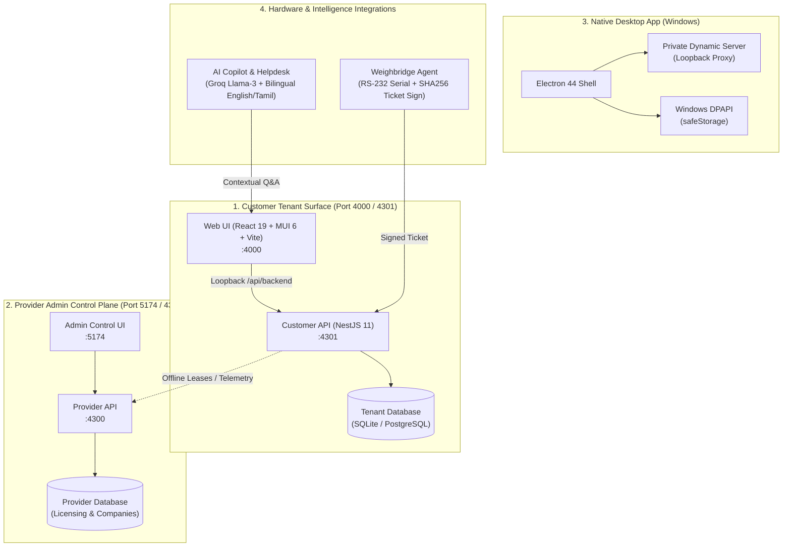
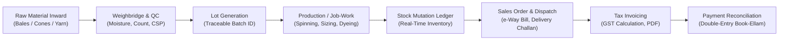

# 🌿 EverGreen — Modern Textile & Yarn Enterprise ERP

[](https://nodejs.org/)
[](https://www.typescriptlang.org/)
[](https://react.dev/)
[](https://nestjs.com/)
[](https://www.electronjs.org/)
[](https://www.prisma.io/)
[](https://www.postgresql.org/)
[](https://vitejs.dev/)
[](docs/wiki/pages/UnifiedWorkspace.md)

> **EverGreen** is an industrial-grade ERP platform engineered specifically for textile manufacturing mills, yarn spinning units, weavers, traders, and job-work processing facilities. It unifies weighbridge telemetry, moisture lab analysis, lot genealogy, multi-tier stock ledgers, double-entry financial bookkeeping, and GST-compliant invoicing into a tamper-evident, reconciliation-driven workflow.

---

## 🧭 Live Service & Port Directory

| Plane / Service | Default URL | Purpose & Capabilities |
| :--- | :--- | :--- |
| **Customer Tenant Web (UI)** | [http://localhost:4000/](http://localhost:4000/) | Staff operational workspace, inventory desks, job-work, invoices & shop |
| **Customer Tenant API** | [http://127.0.0.1:4301/](http://127.0.0.1:4301/) | Isolated business logic, ledger mutations & authentication |
| **Customer API Swagger Docs** | [http://localhost:4000/api/docs](http://localhost:4000/api/docs) | Interactive REST API explorer (Development mode) |
| **Database Console (Prisma Studio)** | [http://127.0.0.1:5555/](http://127.0.0.1:5555/) | Visual database inspector, table records & live schema explorer |
| **Provider Admin Web** | [http://localhost:5174/](http://localhost:5174/) | Provider control plane for license issuance & company provisioning |
| **Provider Admin API** | [http://localhost:4300/](http://localhost:4300/) | Licensing API with isolated admin database |
| **Marketing Showcase** | [http://localhost:3300/](http://localhost:3300/) | Public interactive product simulator & hardware showcase |
| **Native Windows Desktop** | `%LOCALAPPDATA%\Programs\evergreen-desktop` | Packaged offline-capable Electron app with encrypted local store |

---

## 🏛️ Multi-Surface Ecosystem Architecture

EverGreen enforces strict multi-tenancy and data isolation: **one installation and database per customer**, completely separated from the central provider control plane.



---

## 🔄 End-to-End Textile Business Workflow

EverGreen models the physical textile lifecycle. Every command preserves lot ownership, tare weights, moisture shrinkage, available quantities, and closed accounting periods.



1. **Inward Receipt & Weighbridge**: Captures gross, tare, and net weights with optional hardware serial integration and moisture analysis (cotton moisture testing).
2. **Quality & Lot Allocation**: Assigns lots, tracks counts (e.g., 30s, 40s combed/carded), cone counts, and bag weights with tamper-evident checks.
3. **Job-Work & In-House Processing**: Issues materials to external job-work processors, tracks stage transitions, and accounts for process wastage and recovery.
4. **Stock Ledger (Double-Entry Inventory)**: Dispatches and movements are reconciled atomically via transactions to prevent negative stock or ghost lots.
5. **Sales, e-Way & Invoicing**: Automated GST tax calculations (CGST/SGST/IGST), reverse-charge support, and customizable PDF tax invoice generation.
6. **Payment Aging & Book-Ellam**: Double-entry journal entries, customer balance aging, partial payment allocation, and credit controls.

---

## ⚡ Quick Start

### Prerequisites
- **Node.js**: `v22.12.0` or higher
- **npm**: `v10+` (on Windows PowerShell, prefer `npm.cmd` if execution policies apply)

### 1. Installation & Environment Setup
```sh
# Clone repository
git clone https://github.com/gokulsenthilkumar3/EverGreen.git
cd EverGreen

# Install dependencies across all workspaces
npm ci

# Verify configuration (read-only verification check)
npm run setup:check
```

### 2. Database Initialization
```sh
# Generate Prisma Client and deploy SQLite schema
npm run generate -w @evergreen/database
npm run migrate:deploy -w @evergreen/database
```

### 3. Launch Development Services

```sh
# Option A: Start Customer Web UI & API (Ports 4000 & 4301)
npm run dev

# Option B: Start Full Platform (Tenant, Admin, Marketing & APIs)
npm run dev:all

# Option C: Start Solo Operator Ops Cockpit
npm run ops

# Option D: Launch Database Console (Prisma Studio on port 5555)
npm run db:studio
```

---

## 💻 Native Desktop Application (Windows)

EverGreen features a native Windows desktop client built on Electron with an embedded, air-gapped Node.js backend.

### Key Highlights
- **Dynamic Port Negotiation**: Prevents conflicts by dynamically assigning loopback ports on startup.
- **Hardware DPAPI Protection**: Cryptographic secrets and JWT tokens are stored using Windows OS-backed `safeStorage`.
- **Zero Cloud Dependency**: Runs completely offline with a dedicated SQLite database per installation.
- **Fail-Safe Migrations**: Upgrades snapshot the existing database prior to applying schema migrations.

### Local Installation Path
The desktop app is installed on your local machine at:
```text
%LOCALAPPDATA%\Programs\evergreen-desktop\EverGreen.exe
```

### Packaging & Release
```sh
# Build production NSIS installer (EverGreen-1.0.0-win.exe)
npm run dist:desktop

# Launch Electron shell in local dev mode (connects to http://localhost:4000)
npm run desktop
```

---

## 📊 Database Console (Prisma Studio)

Access the visual database console at **[http://127.0.0.1:5555/](http://127.0.0.1:5555/)**.

```sh
npm run db:studio
```
- Inspect and query tables: `Customer`, `User`, `Item`, `StockMovement`, `ProductionEntry`, `JobWorkOrder`, `Invoice`, `Payment`, etc.
- Safe read-only inspection for operations diagnosis and data integrity validation.

---

## 🤖 Bilingual AI Copilot & Helpdesk

EverGreen integrates a localized AI assistant powered by Groq Llama-3:
- **Bilingual Interface**: Full conversational support in **English** and **Tamil (தமிழ்)** for mill operators and accountants.
- **Operational Guidance**: Answers queries on stock reconciliations, GST tax rules, weighbridge tare deduction, and lot tracking.
- **Contextual Helpdesk**: Integrated ticketing with antivirus attachment scanning (ClamAV) and SLA tracking.

---

## 🛡️ Architecture & Verification Gates

EverGreen enforces strict engineering guardrails:

```sh
# Run full verification suite (Prisma schemas, typecheck, boundary tests, unit & e2e tests)
npm run verify

# Knowledge graph commit gate
npm run graph:check

# Rebuild complete codebase architecture graph
npm run graph:build
```

- **Tenancy Boundary**: Customer data is never co-mingled. Every business operates on its own dedicated database.
- **Browser Boundary Guard**: Sensitive Node.js APIs are strictly barred from web bundles.
- **Graphify Engine**: AST-level dependency graph checks every commit against architectural drift.

---

## 📖 Documentation & GitHub Wiki

The repository includes a 38-page technical and operating wiki under [`docs/wiki/`](docs/wiki/):

| Guide | Link | Overview |
| :--- | :--- | :--- |
| **Wiki Directory** | [docs/wiki/README.md](docs/wiki/README.md) | Index of all 38 page-level documentation files |
| **Operator Guide** | [docs/wiki/OPERATING_GUIDE.md](docs/wiki/OPERATING_GUIDE.md) | Standard Operating Procedures from raw material to payment |
| **System Architecture** | [docs/ARCHITECTURE.md](docs/ARCHITECTURE.md) | Multi-tenant topology, data boundaries and provider sync |
| **Business Flow** | [docs/BUSINESS_FLOW.md](docs/BUSINESS_FLOW.md) | Step-by-step checklist of the complete textile lifecycle |
| **Desktop Delivery** | [docs/DESKTOP_DELIVERY.md](docs/DESKTOP_DELIVERY.md) | Packaging contract, updater security, and customer acceptance |
| **Licensing Guide** | [docs/OWNER_LICENSING.md](docs/OWNER_LICENSING.md) | Private key management, DPAPI storage, and offline leases |
| **PostgreSQL Migration** | [docs/POSTGRES_MIGRATION.md](docs/POSTGRES_MIGRATION.md) | Roadmap and dual-schema strategy for Postgres deployment |
| **Knowledge Graph** | [docs/GRAPHIFY.md](docs/GRAPHIFY.md) | Graphify workflow, code navigation, and pre-commit checks |

---

## 📁 Repository Layout

```text
EverGreen/
├── apps/
│   ├── web/                 # Customer Tenant Web SPA (React 19, MUI 6, Vite)
│   ├── api/                 # Customer Tenant REST API (NestJS 11, Prisma)
│   ├── admin-web/           # Provider Control Plane Web Portal
│   ├── admin-api/           # Provider Licensing & Control API
│   ├── marketing-web/       # Product Showcase & Hardware Simulator
│   ├── desktop/             # Electron Desktop Shell & NSIS Packager
│   └── weighbridge-agent/   # Serial hardware weighment connector
├── packages/
│   ├── database/            # Customer Prisma schema & migrations (SQLite & Postgres)
│   ├── admin-database/      # Provider Admin Prisma schema
│   ├── types/               # Shared domain interfaces & licensing contracts
│   ├── pdf/                 # Tax invoice & report PDF generator
│   ├── i18n/                # Localization catalogs (English & Tamil)
│   └── email/               # Transactional email templates
├── docs/                    # Architecture records, audits, specifications & wiki
│   └── wiki/                # 38-page comprehensive operational wiki
├── scripts/                 # Dev orchestrators, release builders & database tools
└── agent-system/            # Autonomous engineering rules & validation suites
```

---

## 📄 License & Intellectual Property

Proprietary software. All rights reserved. Refer to repository terms and customer commercial agreements for distribution and operational conditions.
