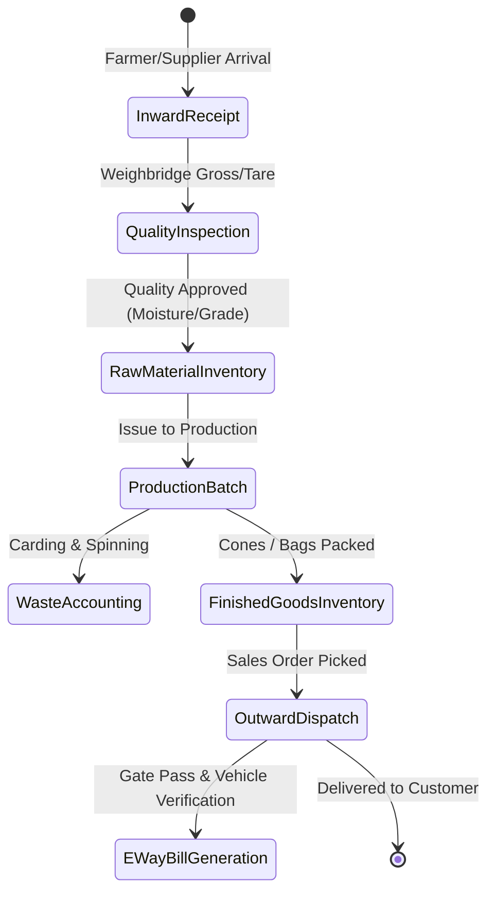
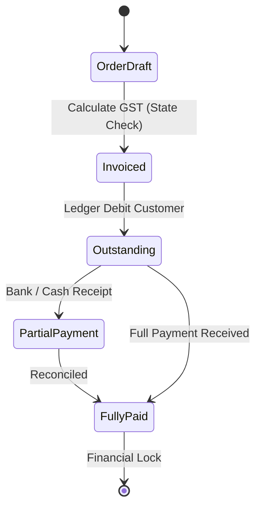

# EverGreen — Complete AI Agent & System Knowledge Guide

> **Target Audience**: AI Coding Assistants, LLMs, Automation Agents, and System Architects.  
> **Design Goal**: Provide 100% full-system domain knowledge in high-density, token-efficient structured markdown **without raw code dumps**.  
> **Token Economy**: Read this single document first. It equips agents to locate, analyze, and edit any component using minimal prompt tokens.

---

## 1. System Topology & Architectural Invariants

| Layer | Technology | Primary Directory | Port / Runtime | Architectural Invariant |
|---|---|---|---|---|
| **API** | NestJS 10, Fastify/Express, Node 20+ | `apps/api/` | `:4000` / `:4301` | Modular monolith. 20+ domain modules. Single company database per deployment. Enforces JWT + RBAC guards on all mutating routes. |
| **Web** | React 19, Vite, MUI v5, TanStack Query | `apps/web/` | `:3000` (dev proxy to API) | Single-Page Application with role-based routing. Zero hardcoded business mock states in production views. |
| **TV / Display** | React Three Fiber, WebGL, Canvas | `apps/web/src/pages/CommandCenter.tsx` | Fullscreen TV mode | Floor monitoring. Auto-recovering animation loops, tab-visibility pause, tour speed controls. |
| **Desktop** | Electron + Local API bundle | `apps/desktop/` (or packaging) | Standalone client | Offline-first sync with SQLite database on company premises. |
| **Shared Types** | TypeScript package | `packages/types/` | `@evergreen/types` | Single source of truth for interfaces, constants, roles, company profiles, and geo primitives. |
| **PDF Engine** | Shared calculation & layout | `packages/pdf/` | `@evergreen/pdf` | Shared GST tax calculations across invoices, orders, and PDF renderers. |
| **Database** | Prisma ORM, SQLite / PostgreSQL | `packages/database/` | `prisma/schema.prisma` | Multi-table relational schema. Strict foreign key constraints and financial ledger audit trails. |

---

## 2. Business Modes & Company Customization ("Multi-Arrowhead" Architecture)

EverGreen is tailored for single-company operations that vary by specialization, vertical, and volume. The platform dynamically adapts via **Business Mode** and **Workspace Mode** (`@evergreen/types`):

```
                        ┌──────────────────────────────┐
                        │   Company Profile Settings   │
                        └──────────────┬───────────────┘
                                       │
            ┌──────────────────────────┴──────────────────────────┐
            ▼                                                     ▼
     [Business Mode]                                       [Workspace Mode]
 ├── INTEGRATED (Full supply chain)                     ├── GUIDED (Low-volume, simple UI)
 ├── WAREHOUSE (Trading & storage only)                 └── FULL (Power-user, complete tabs)
 ├── MILL (Spinning & manufacturing only)
 ├── PROCESSING (Job work & finishing only)
 └── TRADER (Buy/sell catalog distribution)
```

### 2.1 Mode Feature Visibility Matrix

| Module / Tab | `INTEGRATED` | `WAREHOUSE` | `MILL` | `PROCESSING` | `TRADER` | Notes |
|---|---|---|---|---|---|---|
| **Dashboard / Today** | Active | Active | Active | Active | Active | Universal daily summary for all businesses |
| **Inward Entry** | Active | Inactive | Active | Inactive | Inactive | Raw cotton / material intake from farmers & ginners |
| **Production Entry** | Active | Inactive | Active | Inactive | Inactive | Spinning, carding, open-end processing |
| **Inventory Ledger** | Active | Active | Active | Active | Active | Stock balance, custom batch codes, ledger history |
| **Job Work** | Active | Inactive | Inactive | Active | Inactive | Outward contract processing and delivery challans |
| **Yarn Warehouse** | Active | Active | Inactive | Inactive | Active | Storage bin management, pallet tracking |
| **Machine & Quality** | Active | Inactive | Active | Active | Inactive | Spindle metrics, CSP testing, shift logs |
| **Costing & HR** | Active | Inactive | Active | Active | Inactive | Raw material costing, waste analysis, payroll |
| **Commerce & Billing**| Active | Active | Active | Active | Active | GST Invoicing, payments, customer ledger |
| **Command Center (TV)**| Active | Active | Active | Active | Active | Fullscreen factory floor / dock HUD |

### 2.2 Product Specialization ("Arrowheads" & Single vs. Multi Material)

The architecture supports multiple operational archetypes:
1. **Single-Arrowhead (Solo / Low Volume)**:
   - Example: Single raw milk chilling center, single yarn count (e.g. 10s only), or pure job-work dyeing.
   - Behavior: Minimal form fields, automatic sequential batch numbering, guided wizard workflows, zero machinery setup screens required.
2. **Multi-Arrowhead (Diversified Mill & Processing)**:
   - Example: Mill handling multiple counts (2s, 4s, 6s, 8s, 10s), blend compositions (100% cotton vs. poly-cotton), multiple milk types (cow, buffalo, A2), or hybrid processing/trading.
   - Behavior: Multi-line production splits, waste allocation by stage (Blow Room, Carding, OE), costing breakdowns, batch recipe configurations.

---

## 3. Complete Tab & Route Directory

| Group | Tab Name | Route / Alias | Key Capabilities & Business Purpose |
|---|---|---|---|
| **Operations** | Today Dashboard | `/` or `today` | Shift production targets, waste percentages, unit cost/kg, quick receipt shortcuts. |
| | Live Dashboard | `livedashboard` | Real-time floor status visualizer, live machine indicators. |
| | Command Center | `command-center` | 3D Campus scene, dock schedule, vehicle turn-around time, TV display mode. |
| | Inward Entry | `inward` | Farmer / supplier delivery intake, gross/tare weighbridge entry, quality grading. |
| | Production Entry | `production` | Shift log, batch composition, output counts, waste deduction. |
| | Outward Entry | `outward` | Dispatch challans, vehicle number verification, gate pass generation. |
| | Inventory | `inventory` | Stock balances by SKU/batch, physical stock audit, reservation controls. |
| | Job Work | `jobwork` | External process issues, return receipts, processing loss calculation. |
| **Commerce** | Billing / Invoicing | `billing` | GST compliance invoices (intra-state CGST+SGST vs. inter-state IGST), document & line discounts. |
| | Storefront | `store` | Direct customer orders, price list management, catalog showcase. |
| | Payments | `payments` | Cash/bank receipts, partial payment allocations, customer debit/credit balance. |
| | Customers | `customers` | Party ledger, GSTIN validation, credit limit tracking. |
| **Mill & Yard** | Machine Management | `yarnmachine` | Loom / rotor efficiency, breakdown logs, preventative maintenance schedules. |
| | Quality Control | `yarnquality` | Tensile strength, CSP testing, moisture percentage, lot certification. |
| | Warehouse 3D | `warehouse` | Virtual 3D bin layout, bay allocations, forklift routing. |
| | Shift & HR | `yarnhr` | Shift rotations, operator attendance, wage calculation. |
| **System** | Integrations | `integrations` | CSV / Excel master data import (customers, items) with interactive column mapping, preview, and replay idempotency. |
| | Settings | `settings` | Company profile (business mode, workspace mode), tax defaults, print templates. |
| | User Management | `users` | Role-Based Access Control (`VIEWER`, `MODIFIER`, `ADMIN`), password reset. |
| | Audit Logs | `logs` | Immutable audit trail for all write operations, security event tracking. |

---

## 4. End-to-End Business Flow State Machines

### 4.1 Inward-to-Dispatch Flow


### 4.2 Financial & Invoicing State Machine


---

## 5. Foolproof Geolocation & Offline Logistics Architecture

For field material collection (milk centers, raw cotton ginning points), vehicle transit tracking, and weighbridge gate check-ins, EverGreen implements an ultra-reliable, foolproof geolocation architecture:

```
┌────────────────────────────────────────────────────────┐
│               Field Device / Mobile / Tablet           │
│  - Captures: { latitude, longitude, accuracy, time }   │
│  - Signs offline payload with local device HMAC        │
└───────────────────────────┬────────────────────────────┘
                            │
                            ▼
┌────────────────────────────────────────────────────────┐
│            EverGreen Geo-Verification Engine           │
│         (`packages/types/geo.ts` Primitives)           │
├────────────────────────────────────────────────────────┤
│ 1. Haversine Distance Check:                           │
│    distance = 2R * asin(sqrt(...))                     │
│    Validates inside geofence perimeter (e.g. <= 200m)  │
├────────────────────────────────────────────────────────┤
│ 2. Accuracy Sanity Threshold:                          │
│    accuracyMeters <= 100m (flags spoofed / poor GPS)   │
├────────────────────────────────────────────────────────┤
│ 3. Timestamp Anti-Skew & Replay Defense:               │
│    |server_time - device_time| <= 5 min                │
│    (detects cached or simulated coordinates)           │
├────────────────────────────────────────────────────────┤
│ 4. Tamper Flags Audit:                                 │
│    Record stored with immutable verification receipt   │
└────────────────────────────────────────────────────────┘
```

### 5.1 Verification Logic Guarantees
- **Geofence Center & Radius**: Hubs, weighbridges, and delivery docks have configured boundaries.
- **Fail-Safe Tolerance**: Allows operational buffer (e.g., +/- 15m) without compromising security.
- **Offline Integrity**: Records stored in IndexedDB/SQLite while offline preserve hardware GPS timestamps, validated against server time upon synchronization.

---

## 6. Open Commercial & Licensing Model

EverGreen is built to be self-hostable while supporting commercial licensing tiers:

| Tier | Target Scale | Feature Entitlements | License Verification |
|---|---|---|---|
| **Community (Open)** | 1 site, 1-3 users, low volume | Core Inward, Production, Outward, Invoicing, Guided Mode | Free, unlimited local usage, zero telemetry required. |
| **Standard** | 1 site, unlimited users, mid volume | All business modes, CSV master import, Command Center | Signed digital license key (HMAC-SHA256). |
| **Enterprise** | Multi-site, high volume, multi-arrowhead | Multi-warehouse routing, advanced 3D floor, automated backup | Cryptographic license with 30-day offline grace period. |

---

## 7. AI Token Economy: Rules for Coding Assistants

When interacting with or modifying the EverGreen codebase, agents must follow these rules to conserve tokens:

1. **Consult This Specification First**: Avoid reading dozens of source files to understand route names, role policies, or business rules. Everything is cataloged above.
2. **Target Exact Files**: Use the directory mapping in Section 1 and Section 3 to edit or inspect only the relevant file.
3. **Do Not Re-Dump Source Code in Docs**: Keep documentation declarative, tabular, and concise.
4. **Preserve Shared Package Integrity**: Whenever updating `@evergreen/types` or `@evergreen/pdf`, run `npm --workspace=@evergreen/<pkg> run build` so consuming apps (`apps/api`, `apps/web`) receive the compiled artifacts.
5. **Run Scoped Tests First**: Validate with targeted test runners (e.g., `npm --workspace=web test -- src/test/<file>.test.ts`) before running full repo sweeps.
