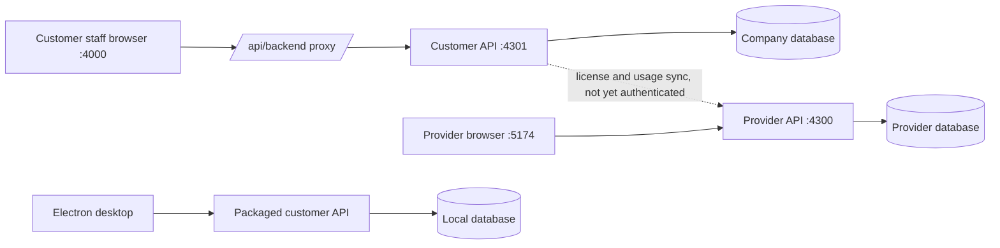

# Architecture

Reviewed against the source on 2026-10-15. This page explains how EverGreen is put together and which code owns each rule. For what is finished and what is still open, see the [project status](PROJECT_AUDIT.md) and the [backlog](IMPLEMENTATION_BACKLOG.md).

## System overview

EverGreen is a textile ERP built as a modular monolith. The repository has 14 npm workspaces: the customer web app and API, the provider web app and API, a marketing site, an Electron desktop shell, weighbridge tooling, and shared packages.

Ports are development defaults and can be overridden. The marketing site runs on port 3300.

### One installation per company

Each customer gets its own web app, API, database, secrets and backups. There is no shared customer database, so operational tables have no tenant ID column. The provider application is a separate system with its own database. Its company records do not provision infrastructure, and warehouse or machine names are not an isolation boundary between sites.

### Databases

Both Prisma schemas use SQLite today, and money is stored as floating-point numbers. The decided target is one PostgreSQL database per customer with exact money types (register items DB-003 and DB-004). That needs a separate schema, migration and reconciliation plan; changing `DATABASE_URL` alone is not enough.

## Customer application (`apps/web`)

| Area | Owner | Responsibility |
| --- | --- | --- |
| Shell and navigation | `src/App.tsx`, `src/utils/navigation.ts` | Lazy-loaded pages, canonical route aliases, browser history, unknown routes |
| Server state | TanStack Query | Fetching, caching and invalidation; components own form drafts |
| HTTP client | `src/utils/api.ts` | `/api/backend` proxy, staff token and session expiry handling |
| Presentation | MUI theme, notification, confirmation and keyboard contexts | Shared UI conventions |
| Documents | `packages/pdf`, `src/utils/*Document.ts` | Invoice calculation and printing from saved snapshots |
| Company preferences | `packages/types/company-profile.ts`, Settings | Business and workspace modes (navigation only) |

Business modes are `INTEGRATED`, `WAREHOUSE`, `MILL` and `PROCESSING`. Workspace modes are `GUIDED` and `FULL`. New installations default to `INTEGRATED`/`FULL`. These modes change what the navigation shows. They do not grant roles, enforce paid modules or separate data.

## Customer API (`apps/api`)

`src/app.module.ts` wires the domain modules: auth, users, sessions, settings, inventory, production, costing, commerce, billing (read-only legacy), job work, warehouse, machines, quality, HR, workflows, integrations, search, dashboard and logs.

A protected request goes through the session/JWT guard and the role guard, then DTO validation, then the controller, domain service and a Prisma transaction. Default role rules separate reads, writes and deletes, and route decorators can tighten them. The roles are `VIEWER`, `MODIFIER` and `ADMIN`. Many legacy handlers still accept `any` bodies, which global validation cannot check (register API-001), so read a handler's own validation before trusting it.

### Consistency owners

| Owner | Responsibility |
| --- | --- |
| `services/prisma.service.ts` | Startup reconciliation and the `stockTransaction` wrapper |
| `services/stock-bridge.ts` | Projecting legacy mill stock into catalogue stock and lots |
| `services/business-ledger.ts` | Journals, valuation, closed-period checks (`assertOpenPeriod`) |
| Domain services | Command validation, ownership, allowed transitions and source-document links |

Rules that every change must keep:

- Any stock change runs inside `stockTransaction`. Connectors and imports call domain commands. They never write ledger tables directly.
- Master-data imports create customers and items only. They post no opening stock or cash.
- Retry protection is per command, not global. Invoices, workflow documents, imports and payments have request keys or fingerprints. Check the specific command before calling a retry safe (register API-008).
- Reconciliation reads broadly and loops inside write transactions. Measure before optimising, and keep the full reconciliation as a cross-check when adding incremental projections (register API-012, PERF-001).

## Provider application (`apps/admin-web`, `apps/admin-api`)

The provider workspace stores company records, license settings, usage snapshots, control records and an audit trail in `packages/admin-database`.

- `ProviderAccessGuard` requires the provider API key. That is one shared credential, not per-operator login (register SEC-003), and it must never be installed on a customer machine.
- Company create, license and metrics routes validate input with DTOs, allowlist the fields they write and bound their numbers. Each license change is written in the same transaction as its audit record. Routine reads no longer return the enrollment API key.
- Saving a license or maintenance flag changes provider configuration only. Nothing confirms that a customer installation applied it. Remote restart, sync and migration return HTTP 503 instead of recording fake success.
- The customer sync job (`apps/api/src/services/admin-sync.service.ts`) is opt-in through `ADMIN_API_URL` and `COMPANY_ID`. It validates the endpoint, rejects redirects, limits the HTTP exchange to 10 seconds and prevents overlapping runs within one API process. It counts actual retained invoices, validates the full license response and keeps an explicit provider suspension. It still sends no credential and reports lifetime rather than billing-period counts, so connected rollout stays blocked (register SEP-002, API-006, BIZ-007). See [configuration and limits](../apps/api/README.md#optional-provider-sync).

## Integrations and adjacent apps

| Surface | What exists | Still needed |
| --- | --- | --- |
| CSV import | Preview, mapping, atomic commit and replay protection for customers and items | Real datasets, operator recovery |
| Tally | XML export of sales and receipt vouchers | Status filtering, ledger mapping and import acknowledgement (INT-001, INT-002) |
| e-Way Bill / e-invoice | Disabled UI and a design contract | Provider credentials, sandbox tests, acknowledgements |
| Weighbridge | Frame parser and HMAC signing library; the entry point is a simulation | Serial capture, device enrollment, replay protection, calibration (INT-006) |
| Command Center | Authenticated Three.js view driven by operational API queries | Device performance; the scene is not sensor telemetry |
| Desktop | Electron shell with a packaged API and local database | Reproducible build, upgrade and restore tests; no offline sync yet (REL-009) |
| Marketing | Separate Vite site | Claims must match accepted features (see the 15 October report) |

Details are in [integrations](INTEGRATIONS.md), [weighbridge agent](WEIGHBRIDGE_AGENT_ARCHITECTURE.md) and [desktop delivery](DESKTOP_DELIVERY.md).

## Shared packages and builds

- `@evergreen/types`: shared types and runtime helpers. Node uses its compiled CommonJS output and bundlers use the TypeScript source.
- `@evergreen/database` and `@evergreen/admin-database`: the two Prisma schemas and migration histories.
- `@evergreen/pdf`: invoice totals, discount allocation and document layout.
- `@evergreen/config`, `@evergreen/email`, `@evergreen/i18n`: configuration, email and localisation helpers.

`npm run build` builds every workspace that has a build script. It does not produce a desktop installer or a container image. `npm run typecheck` covers the customer API (application source plus unit and HTTP tests) and web app only; the other workspaces type-check during their builds. The API check also runs independently with `npm run typecheck -w apps/api`.

## Making a change

1. Trace the path: screen → API client → controller, guard and DTO → domain service → transaction → model → report or print.
2. Cover rejected input, roles, duplicate requests, partial fulfilment or payment, held stock, closed periods, failed writes and stale screens where they apply.
3. Add a regression test that fails before the fix, then run the checks in the [maintenance runbook](MAINTENANCE_RUNBOOK.md).
4. Run `npm run docs:generate` after UI or route changes so the generated references stay current.
5. Record the result against its issue ID in the [shared issue register](audits/2026-10-11/issue-register.md). Do not start a separate list.

Keep the modular monolith, the one-company-per-installation boundary and domain-owned ledgers. Split services or add multi-site support only when measured requirements justify it.
