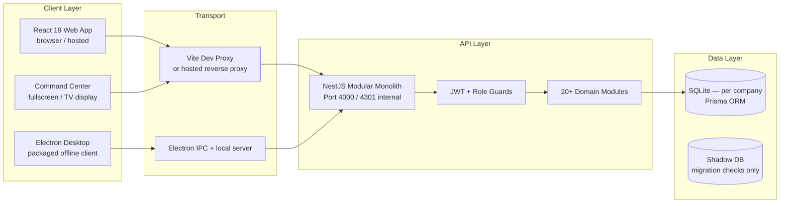
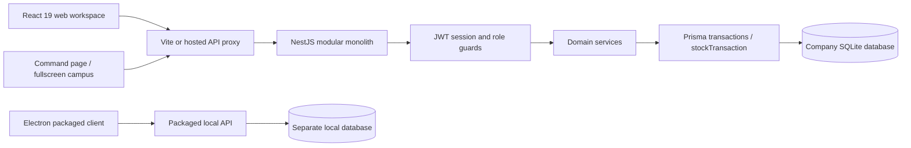

# EverGreen — Architecture Reference

> **Reviewed against active source: 2026-10-10.**  
> Supersedes all historical root-level architectural assumptions.
> Master references: [Agent Knowledge Guide](AGENT_KNOWLEDGE.md), [API](reference/API.md), [models](reference/DATA_MODEL.md), [code ownership](reference/CODE_INDEX.md), [wiki](wiki/README.md).

---

## 1. System Overview

EverGreen is a **modular-monolith ERP** built for the textile/yarn/warehouse/mill industry.  
It serves **one company per installation** but is designed to scale from a single-person startup
to a high-volume multi-site operation via tiered configuration and a licensing model.



---

## 2. Tier Architecture (Volume / Business Mode)

EverGreen adjusts its UI and feature surface based on **two orthogonal axes**:

| Axis | Values | Purpose |
|---|---|---|
| **Business Mode** | `INTEGRATED`, `WAREHOUSE_ONLY`, `MILL_ONLY`, `PROCESSING_ONLY`, `TRADER` | Hides irrelevant workflows |
| **Workspace Mode** | `GUIDED`, `FULL` | Controls navigation complexity |

### 2.1 Business Modes

| Mode | Who uses it | Active modules |
|---|---|---|
| `WAREHOUSE_ONLY` | Traders, distributors — no production | Inward, Outward, Inventory, Billing, Commerce |
| `MILL_ONLY` | Spinning mills (cotton → yarn) | All production + inventory modules |
| `PROCESSING_ONLY` | Job-work contractors | Job Work, Costing, Inventory |
| `TRADER` | Buy-sell multi-product companies | Commerce, Billing, Customers, Catalogue |
| `INTEGRATED` | Full operation (warehouse + mill + processing) | All modules |

### 2.2 Volume Tiers

| Customer Profile | Workspace | Deployment Notes |
|---|---|---|
| **Solo / New** | Guided, minimal master data | Measure time-to-first-receipt with actual operators |
| **Growing** | Full workspace, imports, role management | Test concurrent mutations, restore, ledger reconciliation |
| **High-volume / Multi-site** | Full + site-scoped workflows | Requires site model, pagination, queueing, PostgreSQL migration |

---

## 3. Application Shell (Web — `apps/web`)

### 3.1 Entry and Routing

| File | Responsibility |
|---|---|
| [`main.tsx`](../apps/web/src/main.tsx) | React 19 entry, MUI ThemeProvider, QueryClient |
| [`App.tsx`](../apps/web/src/App.tsx) | Authenticated shell, lazy page loading, global search |
| [`utils/navigation.ts`](../apps/web/src/utils/navigation.ts) | Canonical page aliases, route guards |
| [`theme.ts`](../apps/web/src/theme.ts) | MUI theme factory (light / dark / custom themes) |

### 3.2 Navigation Groups

All navigation is role-gated via `isCompanyPageVisible()` from `@evergreen/types`.

```
OPERATIONS
├── Dashboard (today's summary)
├── Live Dashboard (real-time canvas)
├── Command Center (TV/fullscreen floor view)
├── Inward Entry (raw material receipts)
├── Production Entry (cotton → yarn)
├── Outward Entry (dispatch/shipment)
├── Inventory (stock ledger)
└── Job Work (external processing)

COMMERCE & BILLING
├── Commerce Desk (orders, customers, catalogue)
├── Billing (invoices, payments, credit notes)
├── Workflow Desk (immutable operational documents)
├── Payments (financial operations)
└── Commerce Reports

ANALYSIS
├── Costing (entry, history, sheets)
├── Insights (demand forecasting, analytics)
└── Reports

ADVANCED OPERATIONS
├── Warehouse Management
├── Machine Management
├── Quality Control
├── Shift Management
└── HR Management

SETTINGS & ADMIN
├── Settings (company, rates, customization)
├── Integrations (CSV import, webhooks, Easy/Tally/EWay)
├── User Management (ADMIN only)
├── Security Settings
├── Session Management
└── Activity Logs
```

### 3.3 State Management

| Concern | Tool |
|---|---|
| Server data | TanStack Query (React Query) — cache keyed by entity |
| Form drafts | Local component state |
| Global notifications | `NotificationsContext` |
| Keyboard shortcuts | `KeyboardShortcutsContext` |
| Confirm dialogs | `ConfirmContext` |
| Theme mode | localStorage + useState |

---

## 4. API Layer (NestJS — `apps/api`)

### 4.1 Module Registry

```
app.module.ts
├── DatabaseModule     — PrismaService singleton
├── AuthModule         — JWT login, WebAuthn, TOTP
├── UsersModule        — CRUD users, password management
├── SessionsModule     — Session tracking, device management
├── DashboardModule    — KPI aggregation
├── InventoryModule    — Cotton/Yarn/Waste ledgers
├── ProductionModule   — Production runs, consumption, output
├── CostingModule      — Cost entries, EB rate, maintenance
├── BillingModule      — Invoices, payments, credit notes
├── CommerceModule     — Customers, catalogue, orders, stock movements
├── JobWorkModule      — Challans, dispatch/receipt lines
├── WarehouseModule    — Locations, movements
├── MachineModule      — Machine registry, inspections
├── QualityModule      — Quality inspections, lot holds
├── HrModule           — Staff, shifts, payroll
├── WorkflowsModule    — Immutable operational documents
├── IntegrationsModule — CSV import, webhook manager, Easy/Tally/EWay connectors
├── LogsModule         — Activity audit log
├── SearchModule       — Global full-text search
└── SettingsModule     — SystemSettings, business mode
```

### 4.2 Security Boundary

```
Request → JwtAuthGuard → RolesGuard → Controller → Service → PrismaService
```

| Role | Permissions |
|---|---|
| `VIEWER` | Read-only on all endpoints |
| `MODIFIER` | Read + create/update (no delete) |
| `ADMIN` | Full access including delete, user management, imports |

### 4.3 Business Consistency Services

| Service | File | Responsibility |
|---|---|---|
| `PrismaService` | `services/prisma.service.ts` | Startup reconciliation, `stockTransaction` wrapper |
| `BusinessLedger` | `services/business-ledger.ts` | Double-entry journal, stock valuation, closed-period enforcement |
| `StockBridge` | `services/stock-bridge.ts` | Legacy and catalogue inventory sync |

**Rule:** All stock-mutating operations MUST go through `stockTransaction`. Direct Prisma writes bypass the consistency layer.

### 4.4 Idempotency Pattern

Every write endpoint accepts an optional `requestKey` (UUID/slug). The API:
1. Hashes payload fingerprint
2. Checks `ImportBatch` / `WorkflowDocument.requestKey` for replay
3. Returns existing record on exact replay; rejects changed payload with same key

---

## 5. Desktop App (`apps/desktop`)

Electron wrapper that packages the NestJS API and serves the React web app locally.

```
apps/desktop/
├── main.js        — Electron main process, window management
├── preload.js     — Secure IPC bridge
└── backend/       — Packaged API (must match apps/api parity)
```

> The checked-in desktop backend is NOT automatically in sync with `apps/api`. Always rebuild desktop after API changes.

---

## 6. Shared Packages (`packages/`)

| Package | Purpose |
|---|---|
| `@evergreen/types` | Shared TypeScript types, role constants, import/mapping rules, company profile logic |
| `@evergreen/database` | Prisma schema, migrations, generated client |
| `@evergreen/pdf` | Invoice/document PDF generation, GST calculation helpers |
| `@evergreen/email` | Email notification templates |
| `@evergreen/i18n` | Tamil/English translation strings |
| `@evergreen/config` | Shared configuration utilities |

---

## 7. Command Center (TV / Floor Display)

The **Command Center** (`pages/CommandCenter.tsx`) is the same authenticated web workspace rendered in fullscreen/kiosk mode.

- Uses `FloorCanvas.tsx` (React Three Fiber 3D animated scene)
- Uses `FleetDockTableHud.tsx` for live fleet/dock status
- Reads live data from the same API endpoints (no separate TV service)
- No device pairing service, no telemetry backend
- Animation: Three.js/R3F scene showing warehouse floor; machines, bays, and stock levels are illustrative
- Machine running state, OEE, and delivery ETAs require real sensor integration before being asserted

---

## 8. Integrations Architecture

### 8.1 CSV / Legacy Import (Implemented)

```
User uploads CSV → parseImportCsv() → previewImport() → /integrations/imports/preview
                                                       → /integrations/imports/commit (with requestKey)
                                                       → ImportBatch record + ActivityLog
```

Supported entities: `customers`, `items` (catalogue)

### 8.2 Webhook Manager (Planned)

```
External App (Tally / EWay / Custom) → POST /webhooks/inbound/:tenantKey
                                     → WebhookService.validate() → queue
                                     → WebhookProcessor → domain service
```

Webhook targets: inward receipts, outward dispatch, invoice status, payment confirmations

### 8.3 Easy Bill / Tally Prime / EWay Bill Connectors (Planned)

| Connector | Protocol | Direction |
|---|---|---|
| Easy Bill | REST API / CSV export | Import: invoices, customers, items |
| Tally Prime | TDL / XML API | Bidirectional: vouchers, stock, ledger |
| EWay Bill (NIC) | GST e-Way Bill API | Outbound: generate e-way bills on dispatch |

See [`INTEGRATIONS.md`](INTEGRATIONS.md) for connector implementation specification.

---

## 9. Provider Admin Portal (Pending Implementation)

Proposed separate control plane for EverGreen as a SaaS provider:

```
Provider Portal (separate app/domain)
├── Tenant registry (company name, deployment URL, plan)
├── Subscription management (plan, renewal, entitlements)
├── Health monitoring (API health, backup freshness, connector backlog)
├── Support access (audited, expiring, narrowly scoped)
└── Usage metering dashboard
```

Must NOT share the database with company data planes. Provider operators receive a distinct identity with narrowly scoped, expiring, audited access if company data access is required.

---

## 10. Database Layer

- **Current:** SQLite (one DB per company installation)
- **Target (high-volume):** PostgreSQL (separate migration path required — not a drop-in toggle)

### Schema Domains

| Domain | Models |
|---|---|
| Auth | `User`, `Session`, `WebAuthnCredential` |
| Inventory | `CottonInventory`, `YarnInventory`, `WasteInventory`, `InwardBatch` |
| Production | `Production`, `ProductionConsumption`, `ProductionOutput`, `WipLot` |
| Commerce | `Customer`, `CatalogueItem`, `Brand`, `CatalogueCategory`, `SalesOrder`, `SalesOrderLine` |
| Billing | `Invoice`, `InvoiceItem`, `Payment`, `CustomerLedgerEntry` |
| Logistics | `Outward`, `OutwardItem`, `InwardReceipt`, `InwardReceiptLine` |
| Job Work | `JobWorker`, `JobWorkChallan`, `JobWorkDispatchLine`, `JobWorkReceiptLine` |
| Warehouse | `WarehouseLocation`, `WarehouseMovement` |
| Machines | `Machine`, `MachineInspection` |
| Quality | `QualityInspection`, `StockLot`, `StockHold` |
| HR | `Staff`, `Shift`, `ShiftAssignment`, `PayrollEntry` |
| Workflows | `WorkflowDocument`, `WorkflowLine`, `Supplier`, `StockMovement`, `StockValuation` |
| Accounting | `JournalEntry`, `JournalLine`, `AccountingPeriod`, `CostingEntry`, `CostingSheet` |
| Config | `SystemSettings`, `ImportBatch`, `ActivityLog` |

---

## 11. Architecture Decisions (ADRs)

| # | Decision | Rationale |
|---|---|---|
| ADR-01 | Modular monolith over microservices | Insufficient workload evidence; framework rewrite would not solve company isolation |
| ADR-02 | SQLite for single-company installs | Zero-dependency deployment; PostgreSQL path documented for growth |
| ADR-03 | `stockTransaction` wrapper mandatory | Prevents bypass of business consistency rules by connectors and imports |
| ADR-04 | `requestKey` idempotency on all writes | Network retries safe; duplicate prevention without distributed locks |
| ADR-05 | One company per installation | Shared-database multi-tenancy requires tenant-scoped queries on every table — deferred |
| ADR-06 | Lazy page loading (React Suspense) | Reduces initial bundle; pages load on demand |
| ADR-07 | Connectors translate, never write ledger directly | Domain services own business rules; connectors are translators |
| ADR-08 | Retain reference projects as historical evidence | Reproducible migration audit; source inventory documents origins |

---

## 12. Release Checklist

```bash
npm run generate -w @evergreen/database      # Refresh Prisma client
npm run migrate:check -w @evergreen/database # Shadow DB migration check
npm run typecheck                            # TypeScript across all packages
npm test                                     # All unit tests (API + web)
npm run docs:check                           # Knowledge link validation
npm run build                                # Production build
```

Applying migrations to a customer database requires backup and restore verification before deployment. See [`VALIDATION.md`](VALIDATION.md).

## Implemented structure



The TV experience is the same authenticated web command page; there is no independent TV service, device-pairing service or telemetry backend. Electron has a separate packaging path under `apps/desktop`; the checked-in backend copy is not automatically proof of parity with `apps/api`. Local/hosted bidirectional sync is not implemented.

| Layer | Owner | Contract / boundary |
| --- | --- | --- |
| Routes and shell | `apps/web/src/App.tsx`, `utils/navigation.ts` | Lazy pages; canonical aliases consolidate old customer/order/invoice routes into Business Desk. History changes with navigation. Unknown routes retain 404 behavior. |
| UI state | TanStack Query, local component state | Query cache holds server records; forms hold drafts. A failed request is not a successful write. |
| Company configuration | `packages/types/company-profile.ts`, Settings UI/API | Business mode and guided/full navigation persist per installation. They do not authorize operations or enforce licenses. |
| HTTP client | `apps/web/src/utils/api.ts` | Browser `/api/backend` proxy; configurable base URL; staff JWT attachment; session-expiry handling. |
| API composition | `apps/api/src/app.module.ts` | Auth, users, sessions, inventory, production, costing, billing, commerce, job work, warehouse, machines, quality, HR, workflows, integrations. |
| Security | `guards/jwt-auth.guard.ts`, `guards/roles.guard.ts` | Default read VIEWER, ordinary mutation MODIFIER, delete ADMIN; explicit decorators override. Public routes have explicit annotations. |
| Master imports | `modules/integrations` | ADMIN preview/commit/history; shared pure mapping rules; one database transaction per batch; fingerprint and request-key replay protection; audit attribution from authenticated request. |
| Business consistency | `services/prisma.service.ts`, `business-ledger.ts`, `stock-bridge.ts` | Stock mutations reconcile legacy and catalogue projections, validate managed stock/lots, enforce closed-period snapshots and project journals/valuation. |
| Documents | `packages/pdf`, web document utilities | Saved invoice snapshots and workflow documents own print content. A PDF is not a statutory submission acknowledgement. |

Prisma startup performs reconciliation inside a transaction. Operational changes that affect stock must go through `stockTransaction`; do not bypass it with direct writes from an import or connector. Master imports intentionally create no stock movements, payments or opening balances. Their ordinary transaction is appropriate for customer/item metadata only.

Shared contracts now include runtime validation. `@evergreen/types` exposes compiled CommonJS to Node and TypeScript source to browser bundlers; API prebuild/development startup compiles it first. Deploy its `dist` output with the API. Pointing Node at raw workspace TypeScript is not a reliable production packaging strategy.

## Company and facility boundary

**The current installation owns one company.** `SystemSettings` has one effective settings record, operational rows have no `tenantId`, and roles are company roles. Multiple users, warehouse locations and machines exist inside that company. There is not yet a mill/site dimension throughout production, stock and accounting; multiple named warehouse locations must not be described as fully isolated mills.

For separate customer companies today, provision separate API runtime, database, storage/backups, authentication secret, domain and credentials. Do not switch a shared process between customer databases based on a browser-selected company. Do not expose the database studio to customers.

Target facilities: Company → Sites (warehouse/mill/processing) → zones/bins or equipment. Add stable site IDs to receipts, lots, movements, production, quality and costs; make inter-site transfers balanced and traceable. Existing rows require an explicit default-site migration and reconciliation. Profiles do not fabricate site counts.

## Provider admin portal (pending implementation)

Keep the provider control plane separate from company data planes. Proposed provider entities: Tenant, Deployment, Subscription, Entitlement, UsagePeriod, SupportGrant, Connector and AuditEvent. The provider dashboard lists company name, installation URL, plan, renewal, authorized sites, health, backup freshness and connector backlog. It may provision, upgrade, suspend future writes, restore into a separate environment and manage subscriptions. It must not silently impersonate company staff.

A customer ADMIN manages that company's users, warehouses, settings and imports. A provider operator receives a distinct identity and narrowly scoped, expiring, audited support access if company data access is required. A list of companies is not an authorization boundary. Shared-database tenancy requires tenant scoping on every query, unique key, background job, cache, attachment and webhook, plus cross-tenant negative tests, before release.

## Volume and deployment decisions

| Customer | Workspace | Deployment acceptance |
| --- | --- | --- |
| Solo/new business | Guided profile, minimal master data, one daily flow | Measure time to first receipt/invoice with actual operators; guided mode remains reversible. |
| Growing company | Full workspace, more locations and staff, import batches | Test simultaneous stock mutations, restore, permissions and ledger reconciliation. |
| High-volume/multi-site | Same product, site-scoped workflows and background import/sync jobs | Pending site model, pagination, queueing, performance measurements and production database migration. |

PostgreSQL is a target for higher concurrency, not a drop-in toggle: SQLite-specific migrations, generated Prisma types, transaction isolation, decimal money, indexes, backups and reconciliation need a tested conversion. No throughput or availability SLA is established by passing unit tests.

## Architecture decisions

1. Retain the modular monolith and shared contracts. Extract services only when deployment or workload evidence justifies it; a framework rewrite would not solve company isolation.
2. Keep canonical business commands responsible for stock/accounting. Connectors translate and enqueue; they do not write ledger tables directly.
3. Distinguish asset registration, recorded output and sensor telemetry. Illustrative animation cannot assert machine running state, OEE or delivery ETA.
4. Add company customization without hiding existing records or changing permissions. Existing installations default to INTEGRATED/FULL.
5. Retain reference projects under `backups/` as historical evidence. [Source inventory](SOURCE_FUNCTION_INVENTORY.md) identifies origins, not verified migration parity.

## Release checks

Run `npm run generate -w @evergreen/database`, `npm run migrate:check -w @evergreen/database`, `npm run typecheck`, `npm test`, `npm run docs:check` and `npm run build`. The migrate check uses a disposable shadow database; applying migrations to a customer database is a separate deployment action after backup and restore verification. See [validation](VALIDATION.md) for actual results and outstanding gates.
