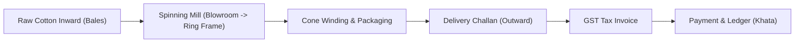
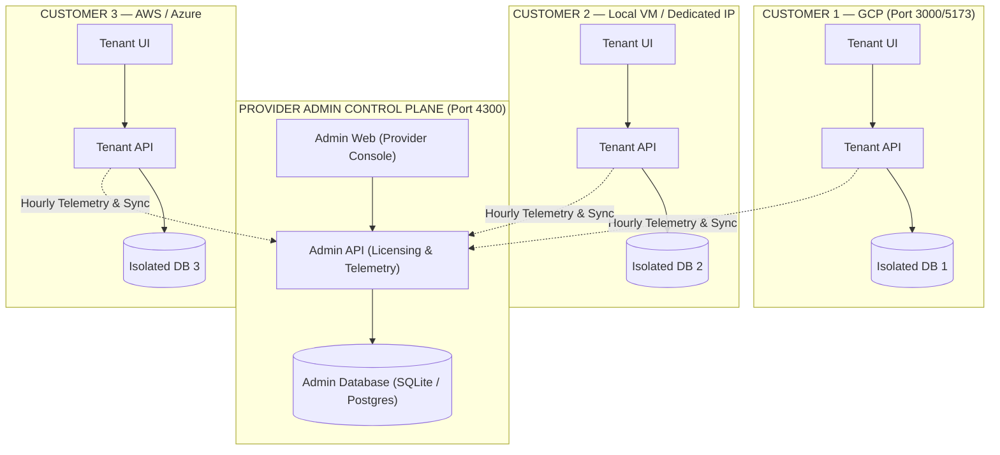

# EverGreen — Complete Architecture, Business Flow & Licensing Guide

> **Audience:** Non-ERP business owners, investors, operators, and developers.  
> **Purpose:** Plain-English explanation of how the business flows, how the software works, how multi-cloud deployments operate, and how provider licensing is enforced.

---

## 1. The Textile & Yarn Business Flow (From Farm to Fabric)

If you have never worked in a manufacturing mill or ERP before, here is the real-world physical journey of textile material:



### 1.1 Inward (Raw Cotton Receipt)
- A truck arrives carrying **cotton bales** from ginning mills or farmers.
- The mill weighs the truck (Gross Weight), unloads the bales, and weighs the empty truck (Tare Weight) to calculate **Net Weight**.
- Samples are tested for **moisture percentage** and staple length.
- The software issues an **Inward Batch Reference** (e.g. `INW-2026-001`). Stock is credited to the warehouse.

### 1.2 Mill Production (Cotton → Yarn)
- Bales are opened in the **Blowroom**, cleaned, and passed through **Carding machines**.
- The fibers are aligned into slivers, drawn, and spun onto bobbins in **Ring Frames**.
- The yarn is wound onto paper cones (e.g., 2.5 kg cones) in **Autoconers**.
- During this process, **waste** is generated:
  - *Comber Noil* & *Card Waste* (usable waste that can be resold).
  - *Hard Waste* (sweepings).
- The system tracks the **Conversion Efficiency** (e.g., 100 kg cotton -> 85 kg yarn + 12 kg saleable waste + 3 kg invisible moisture loss).

### 1.3 Outward & Delivery Challan
- A buyer orders 50 bags of 40s Combed Cotton Yarn.
- The mill prepares a **Delivery Challan** (Outward Gate Pass) noting:
  - Lot Number
  - Number of bags / cones
  - Net weight in Kilograms
  - Vehicle / Lorry Number and Driver Phone.
- Stock is deducted from the warehouse lot.

### 1.4 Commerce Desk & Billing
- The Delivery Challan is converted into an official **GST Tax Invoice**.
- If transported across states or above ₹50,000 in India, an **E-Way Bill** is generated.
- Tax amounts (CGST + SGST for intra-state, IGST for inter-state) are computed automatically.

### 1.5 Ledger & Payment (Khata)
- Every transaction automatically updates the customer's **Ledger Book** (*Peredu* / *Khata*).
- When the customer pays (via NEFT, RTGS, Cash, Cheque), the payment is matched against unpaid invoices.

---

## 2. Company Business Models Supported

EverGreen accommodates 5 distinct company structures without forcing unnecessary screens on them:

| Business Mode | Who it is for | What features they see |
|---|---|---|
| **`WAREHOUSE_ONLY`** | Traders & stockists | Inward, Outward, B2B Orders, Inventory, Invoices |
| **`MILL_ONLY`** | Pure spinning mills | Raw Cotton Inward, Spinning Production, Machinery, Cone Packaging |
| **`PROCESSING_ONLY`** | Job-work contractors (dyeing, sizing) | Job-work inward challan, process tracking, return challan |
| **`TRADER`** | Commission agents & distributors | Multi-product catalogue, Sales Orders, GST Invoices, Khata |
| **`INTEGRATED`** | Full-scale textile enterprise | All modules active: Mill + Warehouse + Commerce + HR + Machinery |

---

## 3. Provider Admin Control Plane vs Tenant Customer Apps

EverGreen utilizes a **Hub-and-Spoke Multi-Cloud Architecture**:



### Why Databases Are Never Shared
- Each customer has their own dedicated database (`dev.db` locally, or managed Cloud SQL PostgreSQL).
- Even if Customer 1 is on GCP and Customer 2 is on an on-premise local VM in Tirupur, **no customer can ever see another customer's data**.
- Security & compliance standards (GDPR, ISO 27001) require strict data isolation.

---

## 4. How Licensing Works (Admin-Only Generation vs Customer View)

### 4.1 Strict Separation of Visibility
- **Provider Admin Web (Only You See This):**
  - Create contracts, assign license keys, set pricing margins, assign tiers, configure quotas, trigger remote migrations, toggle maintenance mode, or suspend instances.
- **Tenant Customer Web (What the Customer Sees):**
  - Customers **NEVER** see license keys, creation forms, internal cost markups, or provider controls.
  - Customers **ONLY** see their **Quota Consumption**:
    - Staff accounts: `1 of 1 used` (or `4 of 15 used`).
    - Registered Machines: `3 of 5 used`.
    - Monthly documents: `140 of 500 posted`.
    - Allowed features: Tabs they didn't pay for are hidden or marked unavailable.

### 4.2 Single-Email vs Multi-Email Licenses
- **Single-Email License (Solopreneur / Solo Mill):**
  - The license strictly allows `maxUsers = 1`.
  - When the customer tries to register or invite a 2nd user, the API throws:  
    `403 Forbidden: User limit reached: Your current license plan allows a maximum of 1 user account. Please upgrade to add more staff.`
- **Team / Multi-Email License:**
  - `maxUsers = N` (e.g. 5, 15, 50). Up to N staff can log in concurrently.

### 4.3 Planetary & Regional Tiers
Different regions have different pricing dynamics:
- **`TIER_1_CITY` (Metro: Mumbai, Bangalore, Chennai, Delhi):** Higher billing rate, full enterprise features.
- **`TIER_2_CITY` (Industrial Hub: Tirupur, Coimbatore, Erode, Surat, Ludhiana):** Competitive manufacturing rate, localized for MSMEs.
- **`RURAL` (Upcountry Village Ginning Mills):** Low-cost seed plan, offline-friendly.
- **`INTERNATIONAL` (Global Exporters: Sri Lanka, Bangladesh, Vietnam):** Multi-currency, international customs documentation.

---

## 5. Automated 1-Line Remote Deployment Script

When you provision a new company in the Provider Admin Portal, the system generates an autonomous bootstrap command:

```bash
curl -fsSL https://admin.evergreen.internal/scripts/auto-deploy.sh | bash -s -- \
  --company-id="<UUID>" \
  --license-key="EVG-T2-XXXXXXXX" \
  --api-key="<SECRET_API_KEY>" \
  --cloud="GCP|AWS|AZURE|LOCAL_VM" \
  --admin-url="http://<PROVIDER_ADMIN_IP>:4300"
```

### What This Script Does on the Customer's IP or Cloud VM:
1. Pulls the pre-packaged EverGreen Docker containers or builds the app.
2. Creates the isolated customer database.
3. Automatically applies all database schema migrations.
4. Stores the provider license token in the local settings.
5. Registers the hourly cron job to push metrics and check license status.

---

## 6. Remote Actions & Management from Admin Web

From the Admin Web, the provider admin can execute remote actions without logging into the customer's machine:

1. **⚡ Trigger Remote Migration (`TRIGGER_MIGRATION`):**
   - When a new software update is released with new database columns, clicking this flag queues a schema migration on the tenant instance during the next sync cycle.
2. **🔧 Toggle Maintenance Mode (`TOGGLE_MAINTENANCE`):**
   - Instantly locks the customer UI with a clean "System Under Maintenance" screen so operators don't enter data during server upgrades.
3. **🚫 Suspend / Reactivate (`SUSPENDED` / `ACTIVE`):**
   - If an invoice is unpaid, the provider flips the status to `SUSPENDED`. The tenant web UI displays an inescapable suspension notice.

---

## 7. What is "Book-Ellam" (Bookellanam / All Books)?

In traditional Indian textile and yarn hubs (Tirupur, Coimbatore, Surat), accounting is rooted in the **Bahi-Khata / Book System**. When a mill auditor or owner says *"Book-Ellam"* (Tamil: புக் எல்லாம் = All books / Every ledger book), they refer to the complete family of commercial registers:

| Book Name | Tamil Term | Purpose |
|---|---|---|
| **Day Book** | *Naal Kurippu* | Chronological record of all daily inflows, outflows, cash, and deliveries |
| **Inward / Purchase Book** | *Varavu Puthagam* | Cotton bale receipts, supplier challans, tare weights, moisture deductions |
| **Outward / Sales Book** | *Vilpanai Puthagam* | Yarn cone dispatches, delivery challans, vehicle gate passes |
| **Stock / Lot Book** | *Sarakku Puthagam* | Bale lot numbers, current kilograms in stock, yarn cone bag counts |
| **Party Ledger** | *Peredu / Khata* | Running debit/credit balance for each customer and supplier |
| **Machine Log Book** | *Yanthira Puthagam* | Spindle breakdowns, maintenance schedules, oiling logs |
| **Waste Register** | *Kasaadu Puthagam* | Comber noil, carding waste, and sweepings tracked for resale |

The **Book-Ellam Research Tool** inside EverGreen allows an owner, auditor, or manager to type a single search query (e.g. `"Raja Traders"`, `"LOT-40S-09"`, or `"TN-38-AB-1234"`) and instantly pull up matching records across **every single book simultaneously**, eliminating hours of manual cross-referencing.
