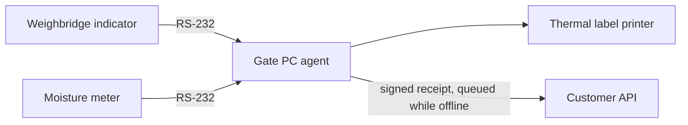

# Weighbridge agent

Package: `apps/weighbridge-agent`. Target host: a Windows 10/11 gate PC connected to the weighbridge indicator and moisture meter over RS-232 or USB-to-serial.

## What exists today

| Part | Source | State |
| --- | --- | --- |
| Indicator and moisture frame parsers | `src/indicator-parsers.ts` | Implemented with 25 unit tests; still accepts some invalid units and trailing text (BIZ-008) |
| Slip signing (HMAC-SHA256) | `src/anti-tamper.ts` | Implemented as a library; no device enrollment, key storage or server-side verification (BIZ-009) |
| Label commands (TSPL and ZPL) | `src/thermal-printer.ts` | Builds command text; not tested against a real printer |
| Entry point | `src/index.ts` | `runAgentSimulation()` feeds a fixed sample frame and key. There is no serial capture (INT-006) |

The receipt screen in the staff app is the supported way to record weighed receipts today.

## Target topology

The agent would parse stable frames, sign each reading with a per-device key, queue it locally when the network drops, and post it to the customer API. None of the serial, queue or enrollment parts exist yet.

## Indicator protocols

The parsers read ASCII frames at 9600 baud.

| Indicator | Example frame | Notes |
| --- | --- | --- |
| Avery Weigh-Tronix (E1205, ZM) | `ST,GS,+014520kg` | `ST` stable, `US` unstable, `GS` gross, `NT` net. Unstable frames are rejected |
| Essae-Teraoka (DS-215, DS-415) | `+014520 kg G` or `<STX>+014520<ETX>` | |
| Mettler-Toledo (SICS) | Send `S`, receive `S S     14520.00 kg` | |

Each model and firmware still needs testing on real hardware.

## Moisture settlement

There is no single regional moisture standard. Each supplier contract sets its own base moisture, deduction bands, premiums and rejection limit. See [cotton moisture research](COTTON_MOISTURE_RESEARCH.md).

For a simple deduction-only contract:

- Net weight = gross weight − tare weight
- Excess moisture % = max(0, measured % − contract base %)
- Deduction (kg) = net weight × excess % ÷ 100
- Billable weight = net weight − deduction

Example with a contract base of 8.5%: gross 14,500 kg, tare 4,200 kg, net 10,300 kg, meter reading 9.2%. The excess is 0.7%, so the deduction is 72.1 kg and the billable weight is 10,227.9 kg.

Physical weight and billable weight must be stored separately, and stock always uses the physical weight. `AntiTamperEngine.calculateCottonMoisture` requires the contract base and throws `RangeError` when it is missing or invalid. It used to assume 8.5% (BIZ-021, fixed 15 October).

## Slip signing

The agent computes an HMAC-SHA256 over `deviceSerial:comPort:grossKg:tareKg:moisturePercent:finalBillableKg:timestamp`. It prints the first 8 hex characters as a seal, in text and as a QR code.

Eight hex characters is only 32 bits, enough to catch accidental edits but not to stop a determined forger. Real verification also needs per-device keys issued at enrollment, a server-side check, and replay protection with sequence numbers or nonces (BIZ-009). Until those exist, do not describe slips as tamper-proof.

## Labels

`ThermalPrinterDriver.generateTsplCommand` (TSC printers) and `generateZplCommand` (Zebra printers) build a 4 × 2 inch label. It holds the company, lot, supplier, bales, gross, tare, moisture, net billable weight, seal and date, plus a Code 128 barcode of the lot and a QR code carrying `LOT`, `NET` and `SEAL`.

Every field value passes through `tsplText` or `zplText` first. These replace control characters with spaces, TSPL quotes with apostrophes, and ZPL `^` and `~` with hyphens, so a supplier name cannot end its field or start a new printer command (INT-011, fixed 15 October). Neither format has been tested on a physical printer.

## Acceptance before field use

Use a real indicator, moisture meter and printer. Test unstable and malformed frames, unplugging and reconnecting, power loss, replayed and tampered payloads, and calibration records. A passing local HMAC test proves integrity under one key. It does not prove calibration or prevent fraud. Work package EG-20 in the [backlog](IMPLEMENTATION_BACKLOG.md) tracks this.
