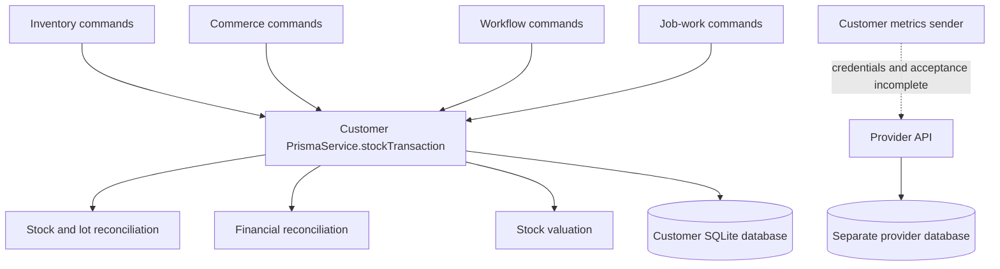

# EverGreen architecture review with Graphify

Reviewed 4 November 2026 against base commit `0307795e7c30ebf796bd8c8311f180485a236791` and the current working tree. The existing `apps/admin-web/src/App.tsx` edit and untracked `polish.css` were preserved. This review adds development tooling and evidence; the application findings below remain open.

Inputs: [Full Technical & Business Review](<../../EverGreen — Full Technical & Business Review.md>), [Reface](../../Reface.md), [current architecture](../../ARCHITECTURE.md), and the [installation/data-boundary decision](../../decisions/0001-installation-and-data-boundaries.md).

## Assessment

Retain the modular monolith, one installation/database per customer, and the separate provider system. The source supports the technical/business review's core concern: reconciliation, persistence and operational acceptance need attention before adding more automation. Graphify helps locate the ownership and impact of these changes; its communities do not establish new deployment boundaries.

`Reface.md` is useful as a navigation inventory. Its introduction says individual source contents were compressed, but later sections describe hardware, tenancy, synchronization and testing as proven capabilities. Those claims need correction or independent acceptance evidence. Source-file and test-file existence alone do not establish a working physical device, a supported offline synchronization protocol or a safe deployment.

## Graph evidence and limits

The initial code-only scan parsed 663 code/configuration files into **5,194 nodes, 12,286 edges and 276 communities**. After adding this tooling and refreshing the graph, the working-tree graph contains **5,240 nodes, 12,340 edges and 275 communities**. Graphify version is **0.9.102**, schema version **1**. The HTML aggregates communities because the graph exceeds its default 5,000-node rendering limit. Generated output is local and ignored by Git.

The first scan reported two tree-sitter syntax regions: `apps/marketing-web/src/App.tsx:1468` and `apps/web/src/components/common/NotFound404.test.tsx:19`. Direct inspection shows ordinary JSX text and a string containing `<script>` respectively. Treat these as extractor limitations pending compiler validation; they do not establish application syntax failures. Eighty-six files yielded no modeled symbols. In particular, source-only AST extraction is not a complete model of CSS, Prisma schemas, dynamically registered routes or runtime HTTP/device interactions. Both Prisma schemas were read directly for this review.

The report distinguishes extracted and inferred relationships. For example, `stockTransaction -> reconcileFinance` is extracted; the caller links from services to `stockTransaction` include inferred links with confidence 0.85. The relevant calls were also checked in source. Degree counts include different relationship types; **44 incident edges does not mean 44 callers**, and high degree in shared i18n utilities is not by itself a defect.

The two supplied Markdown reviews were read directly. This workflow does not semantically index their prose or call a model/API. Long queries can truncate matching nodes; the focused `explain ... --all` result was used for the main transaction boundary.

Reproduce the key queries from the repository root:

```powershell
graphify query "stockTransaction reconcileFinance PrismaService" --context call --budget 1500
graphify explain apps_api_src_services_prisma_service_prismaservice_stocktransaction --all
graphify query "AdminSyncService syncMetrics" --budget 1200
graphify query "GroqAgents runAgentSimulation" --budget 1400
graphify query "JwtStrategy PublicOrderRateLimitGuard" --budget 1200
graphify god-nodes --top 12 --json
```

The broad queries can select both APIs' `PrismaService`. Use the exact node ID above to address the customer transaction boundary.



## Findings, in implementation order

### 1. High priority: posting cost grows with historical data

Graphify places customer `PrismaService` at 97 incident edges and `stockTransaction` at 44 in the initial scan. [prisma.service.ts](../../../apps/api/src/services/prisma.service.ts), lines 117–167, runs repeated stock/lot reconciliation and unscoped `reconcileFinance` inside a transaction with a 60-second timeout. [business-ledger.ts](../../../apps/api/src/services/business-ledger.ts), lines 351–499, loads all costing entries, payroll entries, productions and invoices and iterates through journal posting. Existing touched-item scoping for guards and valuation does not scope these finance scans.

Impact is inferred from the loops and transaction boundary: posting work grows with history. This review does not claim measured save latency or a demonstrated timeout.

Next change: introduce an explicit posting scope for affected source documents/items/lots, preserve the current full reconciliation as a repair/audit operation, and compare both projections on disposable historical fixtures. Acceptance needs stock quantities, valuation, journal balance, closed periods, cancellation and replay equivalence, plus measured query counts and latency at increasing history sizes. Do not remove reconciliation before that equivalence is demonstrated.

### 2. High priority: the persistence target is still unimplemented

The [customer schema](../../../packages/database/prisma/schema.prisma) has **63 models, 110 Float fields and zero Decimal fields**; invoice totals, payments and journal amounts are among those Float fields. The [provider schema](../../../packages/admin-database/prisma/schema.prisma) has 10 models. Both datasources are SQLite. These counts were recomputed directly from the current schema text, rather than inferred from SQL migration nodes.

The decided PostgreSQL-per-customer target remains appropriate to evaluate through a separate migration work package. Changing only a connection URL cannot supply exact money types, data conversion, cutover or rollback. Existing integer/paise invoice calculations help calculation precision but do not change stored Float columns. This is a representation/concurrency risk, not evidence that every stored balance is already wrong.

Acceptance: a disposable SQLite-to-PostgreSQL migration with explicit money/quantity scale decisions, matched counts and balances, sequence checks, a restore drill and a documented cutover. Preserve the installation boundary; operational records currently do not support shared-table tenancy.

### 3. High priority: the proxy and request-write path need operational verification

[main.ts](../../../apps/api/src/main.ts), line 41, trusts only `loopback`. [nginx-tenant.conf](../../../deploy/docker/nginx-tenant.conf) forwards client headers from a separate `tenant-web` container in [compose.yml](../../../deploy/docker/compose.yml). That topology supports the technical review's concern that Express can retain the proxy address as the request IP. It needs a two-client test through the real deployment recipe before changing proxy trust; trusting arbitrary forwarded headers would create a different boundary problem.

[jwt.strategy.ts](../../../apps/api/src/modules/auth/jwt.strategy.ts), lines 28–50, performs session, user and policy reads and awaits a session activity update for an authenticated request. The trailing “fire and forget” comment does not describe the awaited behavior. This adds write traffic independently of business commands.

Acceptance: distinct client identities and rate-limit buckets through the proxy, rejection of spoofed forwarded headers, and coalesced activity updates that preserve revocation, idle timeout and absolute expiry. No production throughput measurement was run here.

### 4. High priority: document numbering and retry semantics need a shared contract

[commerce.service.ts](../../../apps/api/src/modules/commerce/commerce.service.ts), line 1050, still uses `body.invoiceNo || INV-<Date.now()>`. The contemporary default has 17 characters, is not a financial-year sequence and can collide for simultaneous millisecond allocations. The customer schema's unique invoice number can reject a collision; it does not provide transactional allocation. Sales orders and goods receipts also use timestamp defaults at lines 497 and 629. Order/stock/job-work commands have differing replay behavior; a transaction alone is not an idempotency key.

Next change: define a document-series allocator and command-level retry contracts, then test concurrency, retries and cancellation on disposable data. Tax numbering requirements and applicability in the original business review were not legally revalidated here; obtain current acceptance requirements before implementing a statutory series policy.

### 5. High priority: describe integration readiness accurately

The graph locates `runAgentSimulation` in [weighbridge-agent/src/index.ts](../../../apps/weighbridge-agent/src/index.ts), line 16. It uses a fixed sample frame, sample device data and an example signing key. Parser, signature and printer-command utilities exist; this entry point does not open a physical serial port or establish a production device-provisioning boundary. `Reface.md`'s working hardware-daemon wording is stronger than the implementation evidence.

[connector-readiness.service.ts](../../../apps/api/src/modules/integrations/connector-readiness.service.ts), lines 12–18, explicitly reports `liveSync: false`, `registration: false` for e-Way Bills and planned webhooks. Tally XML export and connection/readiness checks are useful existing capabilities, not confirmed two-way posting or statutory registration.

[admin-sync.service.ts](../../../apps/api/src/services/admin-sync.service.ts), lines 59–94, counts lifetime totals and sends JSON with no provider credential. The Docker recipe leaves `ADMIN_API_URL` and `COMPANY_ID` empty. When configured, this sender is separate from the device-proof lease-renewal mechanism in `packages/types/licensing-online.ts`; it does not automatically inherit that mechanism's authentication. [provider-access.guard.ts](../../../apps/admin-api/src/guards/provider-access.guard.ts) requires provider authentication for the company sync routes. A trusted company-scoped sync contract therefore remains open. A sender implementation should not be described as universally disabled, either: configuration controls whether it attempts transport.

Acceptance: one supported physical indicator with provisioned device identity, authorized connector sandbox acknowledgements, replay-safe company-scoped sync and explicit billing-period counters. File names and unit tests cannot substitute for these end-to-end checks.

### 6. High priority: marketing claims lack supporting operational evidence

[marketing App.tsx](../../../apps/marketing-web/src/App.tsx), lines 27–31, labels hard-coded values as active spindles managed, live fraud caught and multi-cloud uptime. The same file describes eliminated fraud and automated Tally entry while the runtime evidence above establishes simulation/export boundaries. This is a source-confirmed mismatch, rather than a Graphify-derived business metric.

Next change: label scenario figures as illustrative, align feature language with supported capabilities and attach real pilot/uptime evidence before publishing measured claims. No market-size, ROI or legal advertising conclusion is asserted by this technical review.

### 7. Medium priority: clarify the shared package's runtime boundaries

Graphify connects `GroqAgents` in [packages/types/ai-server.ts](../../../packages/types/ai-server.ts) to customer helpdesk/assistant and provider assistant consumers. [packages/types/package.json](../../../packages/types/package.json) exposes separate server/licensing subpaths; those implementations include network, filesystem and cryptographic operations. The existing browser root export is distinct, so this is not proof that a key or Node-only module has reached a browser bundle.

Next change: separate browser-safe contracts from server integrations/licensing through explicit packages or enforceable export/import boundaries. Acceptance should compile all consumers and assert that browser entry points cannot import server subpaths or their dependencies.

### 8. Medium priority: use dependency hubs to guide small changes

The graph's initial highest-degree nodes include `uiText` (205), `useUiLanguage` (202), customer `PrismaService` (97), the shared web HTTP client (78) and the customer `App` component (68). These represent shared infrastructure, so broad changes have large review impact. [i18n.ts](../../../apps/web/src/i18n.ts), line 2, imports the Tamil dictionary eagerly, confirming the loading opportunity in the technical review. The old compressed bundle sizes and screen timings were not reproduced.

Next change: lazily load the locale while preserving user language/preferences, then measure the actual production entry bundle and language-switch behavior. For large workflow/commerce services, extract around a documented command boundary with the current ledger rules retained, using the graph's related files to select tests.

### 9. Medium priority: generated documentation is currently stale

`npm run docs:check` exits 1 and lists 43 stale generated references: 37 page guides and six files under `docs/reference/`. This reproduces the technical review's concern about reference drift. The separate local-link check passes. Regeneration and review of the affected references are a maintenance follow-up; this task preserved the supplied reviews and application source rather than rewriting all generated application documentation.

## How to use the supplied reviews

Use the technical/business review to seed the corrective backlog, with the source confirmations and caveats above. Do not treat its older vulnerability, lint, build/test or latency numbers as current results. Current dependency advisories require a new audit, and current market/tax claims require authoritative verification.

Use `Reface.md` to locate candidate modules and acceptance scenarios. Its claims of proven isolation, physical anti-tamper protection, full synchronization and commercial sustainability remain unverified by a directory inventory. Existing test and audit files are valuable evidence to execute and inspect, not automatic production acceptance.

The next implementation package should address posting scope and establish historical-data fixtures. Numbering/replay behavior and persistence migration should follow explicit contracts, while deployment IP attribution and unsupported marketing claims can be handled in small independent changes. Retain the recorded topology and prioritize a real pilot acceptance loop.

## Verification record

- Installed official `graphifyy[sql]` 0.9.102 in an isolated uv tool environment, registered the repository-local Codex skill, generated the graph/report/HTML, and ran the focused queries above without a model/API key.
- Seven commit-gate tests passed, including a real Graphify build/query of staged TypeScript with different unstaged source. The suite also covers failure blocking, warning retention, documentation-only commits, changed indexes and existing-hook preservation.
- A full real Graphify check of the original Git index passed: 680 indexed code files, 5,810 nodes and 14,035 raw edges. It had no staged changes and retained the index; this snapshot used the original committed ignore rules, which explains its difference from the working-tree graph.
- The actual installed hook was then exercised with `git hook run pre-commit`, without creating a commit. It passed against **28 staged files**, parsed **667 code files** into **5,279 nodes and 12,221 raw edges**, and identified **113 changed nodes and 24 related files**. All three scoped queries succeeded. Parser warnings were retained in `.evergreen/graphify/b9426bd1ada1ca76e4b8dc5383a136d07757560fef57f17eeb175a37bc655301.json`. The staged snapshot and local clustered graph use different processing modes and are reported separately.
- Repository-local `core.hooksPath` is `.githooks`. The blocking staged gate is enabled here. Other clones need the documented setup; the new CI workflow runs after this change is committed and pushed. Remote required-check/branch-protection settings were not changed.
- Node syntax checks passed for both new scripts.
- The focused customer API run passed **4 suites and 80 tests**: `prisma.service.spec.ts`, `business-ledger.spec.ts`, `inventory.weighbridge.spec.ts`, and `admin-sync.transport.spec.ts`. These use mocked/disposable state; they do not establish physical-device, historical-load or live connector acceptance. Command: `npm.cmd test -w apps/api -- --runInBand --runTestsByPath src/services/prisma.service.spec.ts src/services/business-ledger.spec.ts src/modules/inventory/inventory.weighbridge.spec.ts src/services/admin-sync.transport.spec.ts`.
- `node scripts/check-knowledge-links.mjs` passed with **3,589 local links**. `npm.cmd run docs:check` exited **1** with **43 stale generated references**, as described above. The full `npm run verify` suite was not run.
- No production database, external connector, deployment, physical device, browser performance run or full application verification was performed by this review. Source-confirmed risk and a graph relationship are not a demonstrated runtime failure.

Setup and daily commands: [Graphify workflow](../../GRAPHIFY.md).
