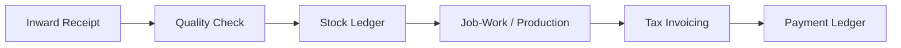

# 🌿 Welcome to the EverGreen Knowledge Wiki

Welcome to the official documentation and operating wiki for **EverGreen** — the industrial enterprise ERP built for textile manufacturing mills, spinning units, yarn traders, and job-work processing facilities.

---

## 🚀 Quick Navigation

### 1. Operations & Mill Floor
* **[Inward Entry](InwardEntry)**: Raw bale, cone, and yarn receipt with weighbridge integration and moisture testing.
* **[Production Entry](ProductionEntry)**: Mill batching, spinning schedules, stage output recording, and waste recovery.
* **[Job Work Processing](JobWork)**: Outward job orders to sizing, dyeing, or twisting facilities, with shrinkage and return reconciliation.
* **[Inventory Ledger](Inventory)**: Real-time multi-site stock tracking with tamper-proof transaction histories.

### 2. Commercials, Billing & Accounting
* **[Commerce Desk](CommerceDesk)**: Customer orders, rate contracts, proforma generation, and dispatch tracking.
* **[Book-Ellam (Double Entry)](BookEllam)**: Integrated ledger balancing, credit limits, payment receipts, and balance aging.
* **[Tax & Compliance](yarn-ComplianceReports)**: GST filing reports, e-Way bills, HSN classification, and audited invoices.

### 3. Mill Floor IoT & Security
* **[Hardware Integrations](Integrations)**: RS-232 serial weighbridge scales, digital moisture testers, and thermal barcode printers.
* **[Security & RBAC](SecuritySettings)**: Role-based permissions (`VIEWER`, `MODIFIER`, `ADMIN`), TOTP two-factor authentication, and IP fencing.
* **[Helpdesk & Staff Support](Helpdesk)**: Context-aware ticketing with ClamAV attachment scanning and bilingual support.

---

## 📖 Operational Pillars

1. **Reconciliation-First**: Stock movements and invoices are bound to atomic database transactions. No negative inventories or ghost lots.
2. **Strict Multi-Tenancy**: Every customer runs an isolated database and application instance. Data is never co-mingled.
3. **Air-Gapped Desktop Support**: The desktop client functions seamlessly offline with OS-level encrypted storage.
4. **Bilingual Accessibility**: Full English and Tamil (தமிழ்) localization designed for floor operators and management.

---

## 🛠️ Need Help?
For emergency operational issues or bug reporting, consult the **[Operating Guide](OPERATING_GUIDE)** or submit a ticket via the **[Helpdesk](Helpdesk)**.

